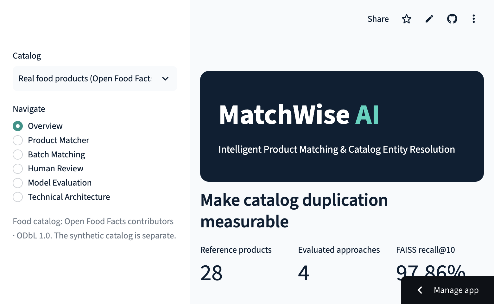
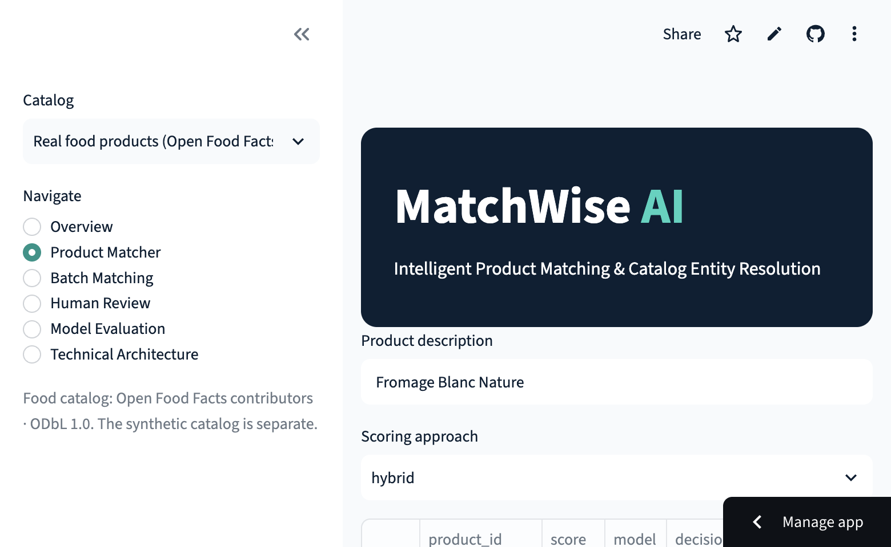
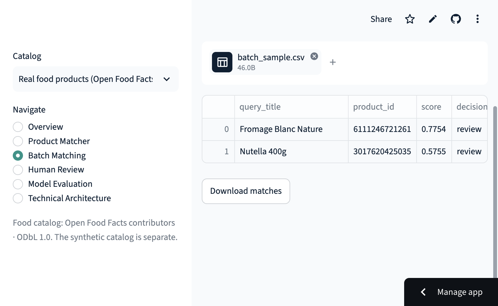
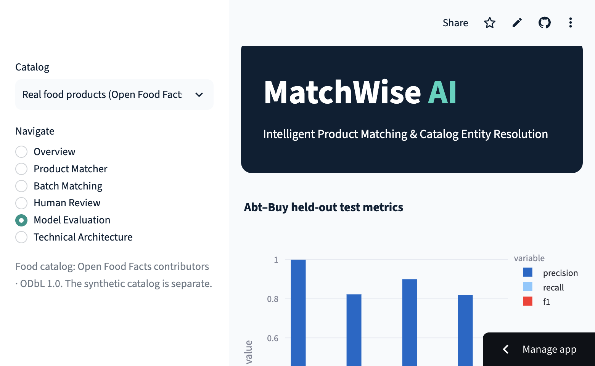

# MatchWise AI

Intelligent Product Matching & Catalog Entity Resolution Platform.

[GitHub repository](https://github.com/Akanksha2097/ai-product-matching-engine)

[Live Streamlit application](https://matchwise-ai-akanksha2097.streamlit.app/) · [Sample batch CSV](data/demo/batch_sample.csv)

MatchWise demonstrates a product-matching workflow for inconsistent retail catalog records. It combines conservative normalization, TF-IDF candidate retrieval, RapidFuzz baselines, MiniLM sentence embeddings, FAISS retrieval, a logistic-regression hybrid, FastAPI endpoints, and a Streamlit review interface. The benchmark and food demo use **separate datasets**; no cross-dataset matches are claimed.

## Quick start

```bash
python3.11 -m venv .venv
source .venv/bin/activate
pip install -e '.[dev]'
python scripts/run_evaluation.py
pytest -q
streamlit run app/streamlit_app.py
uvicorn src.api.main:app --reload
```

The hosted-ready food catalog contains 28 real Open Food Facts records, attributed under ODbL 1.0. A separate synthetic fixture drives deterministic tests. The labeled Abt–Buy benchmark is evaluated locally and its source records are **not redistributed**. Public source and attribution notes are in [docs/data_sources.md](docs/data_sources.md).

## Measured evaluation

DeepMatcher Abt–Buy: 9,575 labeled pairs, split 60/20/20 by left-side product ID. FAISS candidate recall@1/5/10 was 0.7403/0.9484/0.9786. At thresholds selected to target at least 90% validation precision, held-out test results were:

| Model | Precision | Recall | F1 |
| --- | ---: | ---: | ---: |
| RapidFuzz | 1.0000 | 0.0191 | 0.0376 |
| TF-IDF | 0.8222 | 0.1770 | 0.2913 |
| MiniLM semantic | 0.9000 | 0.0431 | 0.0822 |
| Logistic hybrid | 0.8205 | 0.1531 | 0.2581 |

The hybrid did not beat TF-IDF, and validation precision did not always carry over to test. Right-side entities can recur across splits. See [docs/evaluation.md](docs/evaluation.md) and [machine-readable results](data/demo/benchmark_evaluation.json).

## Architecture

Public catalog → validation and normalization → cached Parquet → blocked TF-IDF retrieval → fuzzy / TF-IDF / hybrid scoring → auto-match, review, or reject → API and dashboard.

See [docs/architecture.md](docs/architecture.md), [docs/methodology.md](docs/methodology.md), and [docs/model_card.md](docs/model_card.md).

## Live application screenshots

These screenshots were captured from the deployed application after browser verification.









The live food-catalog scoring is a heuristic demo; the Abt–Buy benchmark metrics do not validate its thresholds. Review history is stored in a local SQLite file that may be reset by Community Cloud; export it for retention.

## API

`GET /health`, `GET /model-info`, `POST /match`, and `POST /batch-match`. Example:

```bash
curl -X POST http://127.0.0.1:8000/match -H 'content-type: application/json' -d '{"query":"HP 67 XL black ink cartridge","k":3}'
```

## Quality and provenance

CI runs Ruff, pytest (including all dashboard pages), and the evaluation smoke pipeline. Public ingestion is bounded, cached, and rate-limit respectful. To reproduce the full CPU benchmark, install `pip install -e '.[semantic]'`, download the five Abt–Buy CSVs listed in [docs/data_sources.md](docs/data_sources.md) to `data/raw/abt_buy/`, and run `OMP_NUM_THREADS=1 python scripts/evaluate_benchmark.py`. The first model download requires network access; subsequent runs use the Hugging Face cache.

## Portfolio materials

See [docs/portfolio_case_study.md](docs/portfolio_case_study.md), [docs/linkedin_showcase.md](docs/linkedin_showcase.md), and [docs/limitations.md](docs/limitations.md). The public repository and live app links above were verified on November 4, 2026 (US Central time).
