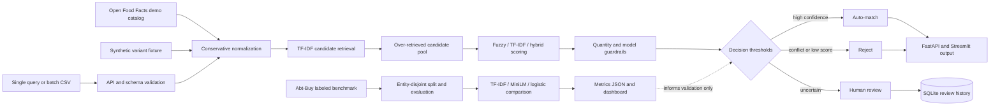

# Architecture

The Mermaid source below represents the implemented system, including the intentionally separate demo and benchmark paths.

`ingestion` retrieves permitted public data with caching and retries. `preprocessing` validates and standardizes attributes. `candidate_generation` avoids all-pairs comparison with TF-IDF retrieval. `models` produces interpretable fuzzy, TF-IDF, and hybrid ranking scores. The matching engine retrieves more candidates than the requested output count, applies variant guardrails, ranks the pool, and only then returns top-k. FastAPI exposes a validated API and Streamlit provides interactive review and batch workflows.

The dashed edge is deliberate: benchmark measurements inform evaluation practice, but the Abt-Buy results are not presented as calibration or accuracy for the separate food demo.
